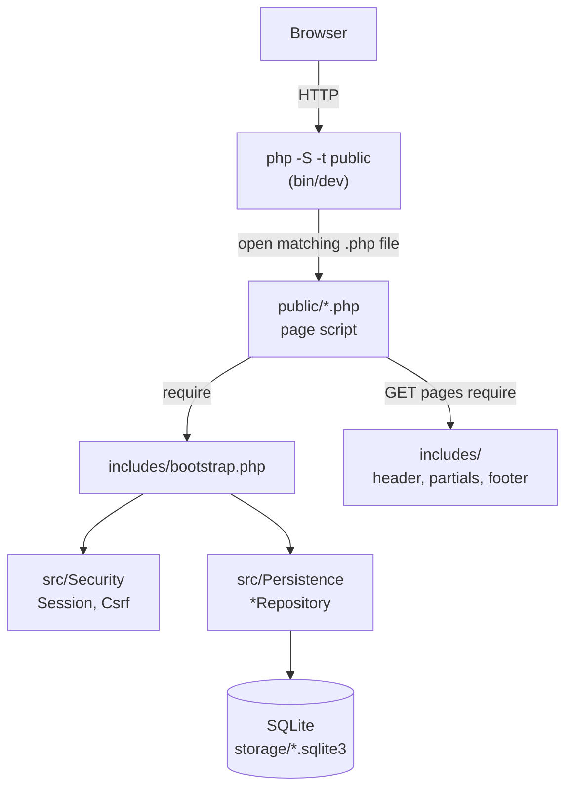
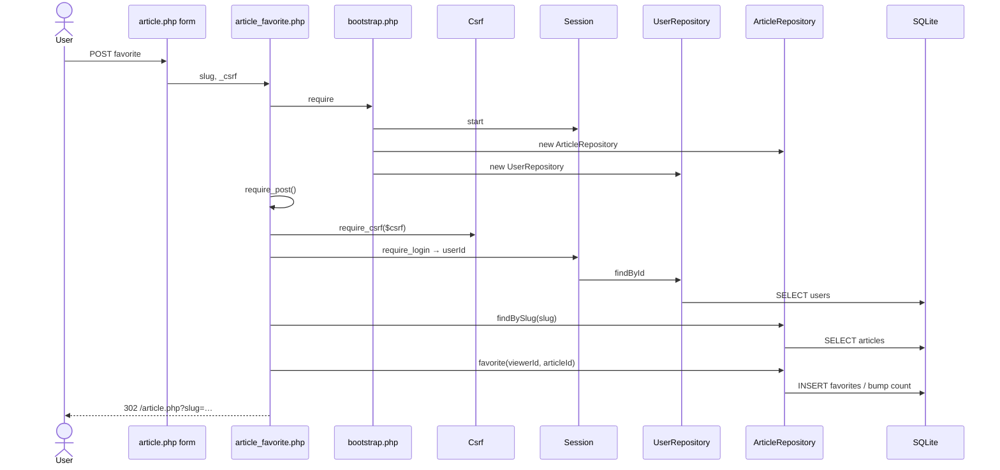
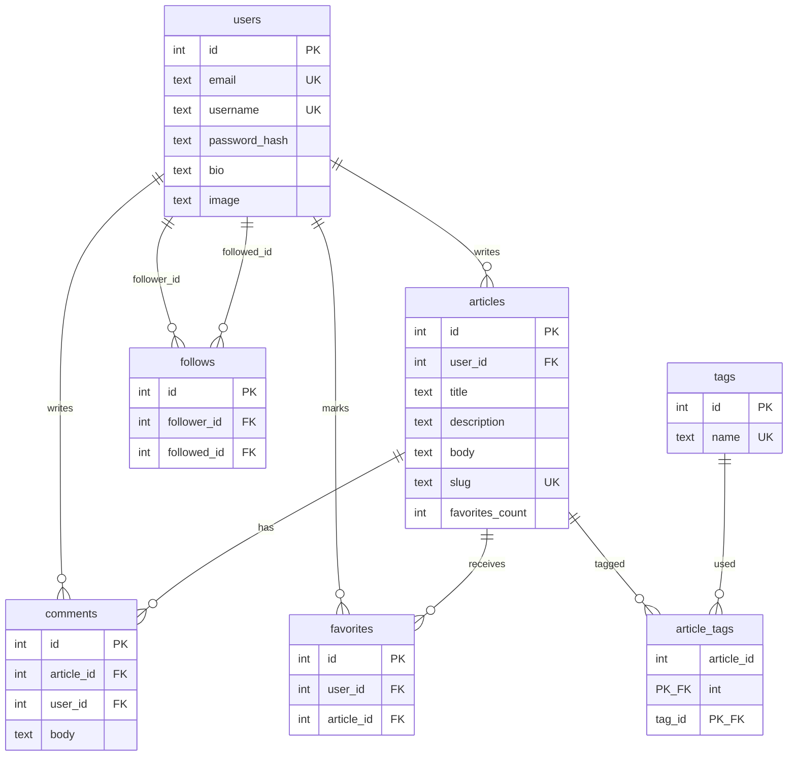

# Architecture

Visual map for agents and humans new to this Conduit PHP app. Coding norms stay in [`AGENTS.md`](../AGENTS.md) and [`.cursor/rules/`](../.cursor/rules/).

## Request stack

The web server maps the URL to a file under `public/`. There is no app-level router. Shared boot lives in `includes/bootstrap.php`.

GET pages load data, set chrome variables (`$title`, `$viewer`, `$csrfToken`), then `require` the HTML includes. POST siblings such as `article_favorite.php` act and redirect without rendering a full layout.

## Favorite POST walkthrough

Example of a mutating page script. Source of truth: `public/article_favorite.php` plus helpers in `includes/bootstrap.php`.

Other POST endpoints (`follow.php`, `comment_create.php`, `login.php`, and similar) follow the same shape. Guard, load, mutate through a repository, redirect.

## Data model

Tables and foreign keys from `sql/schema.sql`.

Repositories under `src/Persistence/` run SQL against these tables and return associative arrays for the page scripts. They are not rich domain entities.
