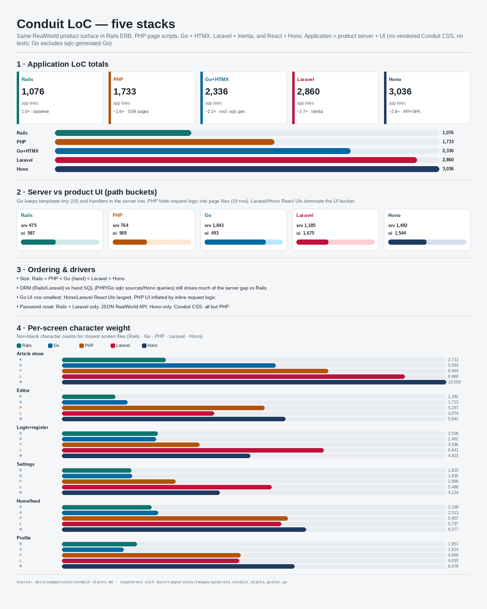

# Conduit stacks — five-way comparison

Same RealWorld (Conduit) product surface under `apps/`. Numbers are fresh `cloc` on this monorepo (git-tracked sources). Exclusions match the earlier three-way note: no `node_modules`, lockfiles, or generated Drizzle migration snapshots; vendored Conduit Minimal CSS is listed separately, not in “application.”

| App | Path |
| --- | --- |
| Rails ERB | [`apps/rails-erb`](../../apps/rails-erb) |
| PHP page scripts | [`apps/php`](../../apps/php) |
| Go + HTMX | [`apps/go-htmx`](../../apps/go-htmx) |
| Laravel + Inertia | [`apps/laravel-inertia`](../../apps/laravel-inertia) |
| React + Hono | [`apps/react-hono`](../../apps/react-hono) |

*Poster summary of the tables below. The older three-way writeup remains at [`rails-hono-php.md`](./rails-hono-php.md).*

## High-level LoC

**Application** = product server + UI code (no vendored Conduit CSS, no tests).

| Bucket | Rails ERB | PHP | Go + HTMX | Laravel + Inertia | React + Hono |
| --- | ---: | ---: | ---: | ---: | ---: |
| Application | ~1,076 | ~1,733 (~1.6× Rails) | ~2,336 (~2.2×) | ~2,860 (~2.7×) | ~3,036 (~2.8×) |
| Tests | ~592 | ~314 | ~293 | ~351 | ~1,105 |
| App + tests | ~1,668 | ~2,047 | ~2,629 | ~3,211 | ~4,141 |
| Vendored Conduit CSS | 1,205 | — (custom `app.css` ~313) | 1,205 | 1,221 | 1,205 |

Method notes:

- **Rails** — `apps/rails-erb/app/` minus `conduit.css`.
- **PHP** — `public/` (excl. CSS) + `includes/` + `src/`.
- **Go** — `cmd/` + `internal/` (excl. `*_test.go` and sqlc-generated `*.sql.go` / `models.go`) + `templates/` + `sql/queries` + `sql/schema`. Generated sqlc output (~1,060) is **not** in Application; it is derived from the counted SQL sources.
- **Laravel** — `app/` + `routes/` + `resources/js` + `resources/views` + non-conduit CSS under `resources/css`. Includes some unused Breeze UI leftovers (~333 in `Components/`); Conduit pages/layouts dominate the UI row.
- **Hono** — `apps/api/src` + `apps/web/src` excl. `*.test.*` + `packages/{db,contracts}/src`.
- **Tests** — Rails `test/`; PHP `tests/` + `e2e/`; Go `*_test.go` + `e2e/`; Laravel `tests/` + `e2e/`; Hono API `test/` + web `*.test.*` + `e2e/`.

### Server vs product UI

Path buckets: code that mainly talks to the DB / enforces request rules on the server, versus code that mainly produces what the browser shows.

| Row | Rails | PHP | Go + HTMX | Laravel | Hono |
| --- | ---: | ---: | ---: | ---: | ---: |
| Server / persistence | ~475 — models, controllers, helpers, jobs, mailers | ~764 — `src/` | ~1,843 — `cmd` + `internal` (hand) + SQL sources | ~1,185 — Models, Http, Policies, Support, routes | ~1,492 — API + db/contracts packages |
| Product UI / pages | ~587 — views, JS, `application.css` | ~969 — `public/*.php` + `includes/` | ~493 — `templates/` | ~1,675 — Inertia React + blade shell | ~1,544 — `apps/web/src` |

**What you can read**

- Rails stays the smallest overall; Active Record keeps the server row thin.
- Go’s **UI row is the smallest** (~493 templates): handlers live in `internal/httpx` (server row). That is the inverse of PHP, where page scripts fold request logic into the UI row.
- Laravel sits between Go and Hono on totals: Eloquent + Policies on the server, Inertia React pages on the UI (closer to Hono’s SPA cost than to ERB).
- Hono remains largest: JSON API + SPA client lifecycle.

**What you should not read**

- Do **not** treat PHP’s two rows as “backend vs frontend” the way Rails/Hono/Go/Laravel are. Each `public/*.php` owns auth/CSRF/redirects **and** HTML.
- Do **not** treat Go’s large server row as “more domain complexity than Hono.” Go counts HTML handlers + hand SQL in one bucket; Hono’s HTML is mostly in the SPA (UI row) and its JSON adapters inflate the server row for a different reason.
- Do **not** treat Laravel’s UI row as pure product Conduit screens — unused Breeze components still contribute ~333 lines.

## Architecture

| Concern | Rails ERB | PHP | Go + HTMX | Laravel + Inertia | React + Hono |
| --- | --- | --- | --- | --- | --- |
| Request story | Router → controller → ERB / Turbo | Web server opens `public/*.php` | chi → handler → template / HTMX partial | Router → controller → Inertia page props | Hono `/api/...` JSON → React SPA |
| Rendering | Server HTML + Hotwire | Server HTML via includes | Server HTML + HTMX swaps | Inertia (React) over Laravel | Client SPA (React Router, TanStack Query) |
| Authority | CanCanCan `Ability` | Inline session / ownership in pages | Inline in handlers | Laravel Policies | Server `permissions` JSON; SPA renders flags |
| URL style | Resourceful HTML | Query-string `.php` pages | Resourceful HTML | Resourceful HTML | RealWorld API paths + SPA routes |
| CSS | Conduit Minimal | custom `app.css` | Conduit Minimal | Conduit Minimal | Conduit Minimal |

Favorite mutation shape:

- Rails — Turbo Stream partial
- PHP — POST + 302 full reload
- Go — HTMX partial swap (full-page fallback)
- Laravel — Inertia visit / reload props
- Hono — client mutation against JSON API

## Auth and session

| | Rails | PHP | Go + HTMX | Laravel | Hono |
| --- | --- | --- | --- | --- | --- |
| Session | Signed cookie → `Session` row | PHP session cookie | Cookie → `sessions` row + CSRF | Laravel session cookie + CSRF | JWT in `localStorage` |
| CSRF | Rails token | `_csrf` forms | `_csrf` / `X-CSRF-Token` | Laravel defaults | None (Bearer API) |
| Passwords | `has_secure_password` | `password_hash` | bcrypt | Eloquent hashing | scrypt |
| Password reset | Yes | No | No | Yes (Breeze) | No |

## Server / data access

| | Rails | PHP | Go + HTMX | Laravel | Hono |
| --- | --- | --- | --- | --- | --- |
| Style | Active Record | PDO repositories, raw SQL | sqlc (hand SQL → generated Go) + txs in handlers | Eloquent + Policies | Drizzle schema + hand query modules |
| Article SQL / model weight | `article.rb` ~66 + controllers | `ArticleRepository` ~349 | SQL sources + handler orchestration (generated excluded) | `Article` model + `ArticleController` | `queries.ts` + `service.ts` ~316 |

ORM vs hand SQL still explains most of the **Rails vs PHP/Go/Hono** server gap. Laravel and Rails share the Eloquent/AR side of that split; Go and PHP/Hono share hand-SQL cost (Go via sqlc sources).

Hono’s server row remains ~2× PHP’s mainly because of the **RealWorld JSON API + contracts + wiring**, not because article SQL is twice as large — see [`rails-hono-php.md`](./rails-hono-php.md#why-honos-server-row-is-2-phps) (still accurate).

## Frontend / page size

Product UI (excl. vendored Conduit CSS):

| | Rails | PHP | Go + HTMX | Laravel | Hono |
| --- | ---: | ---: | ---: | ---: | ---: |
| Total | ~587 | ~969 | ~493 | ~1,675 | ~1,544 |

### Same screens — non-blank lines and characters

Closest product surface files per screen (Hono may include sibling components a page imports; PHP pages include request logic + markup).

| Page | Rails | Go | PHP | Laravel | Hono |
| --- | ---: | ---: | ---: | ---: | ---: |
| Article show | 69 / 2,713 | 152 / 5,583 | 132 / 6,963 | 191 / 8,960 | 285 / 10,038 |
| Editor | 38 / 1,392 | 42 / 1,713 | 130 / 5,297 | 81 / 3,974 | 161 / 5,841 |
| Login + register | 52 / 2,508 | 64 / 2,462 | 100 / 3,596 | 145 / 6,841 | 142 / 4,923 |
| Settings | 35 / 1,810 | 44 / 1,835 | 78 / 2,966 | 106 / 5,480 | 121 / 4,124 |
| Home / feed | 71 / 2,338 | 84 / 2,513 | 152 / 5,907 | 131 / 5,737 | 174 / 6,377 |
| Profile | 49 / 1,957 | 47 / 1,614 | 111 / 4,669 | 95 / 4,633 | 159 / 6,076 |

Reading the table:

- **Go vs Rails** — both SSR HTML; Go templates stay near ERB size on most screens. Extra Go weight is more often in `internal/httpx` (server row) than in markup.
- **Laravel vs Hono** — both React UIs. Laravel wins some screens by receiving props from controllers (less client fetch/lifecycle); Hono still pays SPA query/mutation state. Laravel Auth pages are heavy partly from Breeze password-reset/verify screens.
- **PHP** — SSR but thick page scripts; chars often between Rails/Go and the React stacks.

## Testing

| | Rails | PHP | Go + HTMX | Laravel | Hono |
| --- | --- | --- | --- | --- | --- |
| Fast layer | Controller integration + Ability | Repository PHPUnit | sqlc/DB tests + thin `httptest` | Feature / HTTP tests + Policies | API contract + query tests; thin Vitest |
| Browser | Capybara system | Playwright | Playwright | Playwright | Playwright |
| Untested in isolation | — | Page scripts | Templates | Inertia page components (prefer e2e) | Full pages under mocks |

Qualitative detail: [`testing-strategies.md`](./testing-strategies.md).

## Notable asymmetries

- Password reset: Rails + Laravel only.
- Conduit Minimal CSS: Rails, Hono, Go, Laravel. PHP keeps a smaller custom sheet.
- JSON RealWorld API: Hono only.
- HTMX partial favorites/follows: Go (Turbo analogue on Rails; Inertia/Hono client mutations elsewhere).
- Laravel still carries unused Breeze Tailwind/component leftovers beside Conduit pages.

## Takeaways (factual)

1. **Application size order (small → large):** Rails (~1.1k) → PHP (~1.7k) → Go (~2.3k) → Laravel (~2.9k) → Hono (~3.0k).
2. **ORM vs hand SQL:** Rails/Laravel keep article/list SQL out of application code; PHP/Go/Hono pay for it (Go via sqlc sources; generated Go excluded from Application).
3. **UI shape:** Go templates are the thinnest UI row. Rails ERB next. PHP pages are thicker because they inline the request story. Laravel Inertia and Hono SPA are the heavy React UIs.
4. **Auth:** cookie + CSRF on Rails, PHP, Go, Laravel; JWT on Hono. Password reset only on Rails and Laravel.
5. **Tests:** all five lean on browser/system or Playwright for flows; none make full page/UI scripts the primary unit-test target.
