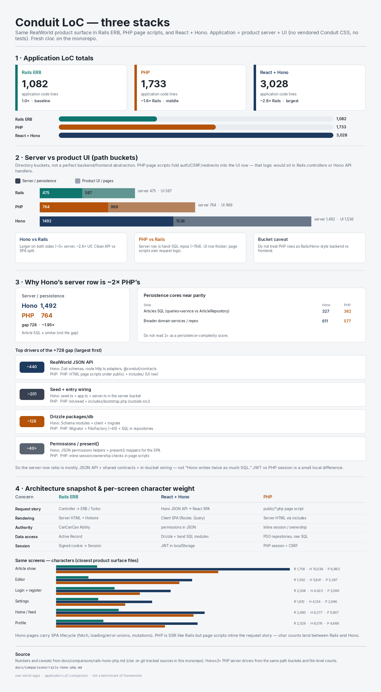

# Rails ERB / React+Hono / PHP — three-way comparison

Same Conduit (RealWorld) product surface in three stacks under `apps/`. Numbers are fresh `cloc` on this monorepo (git-tracked sources). Exclusions match prior Rails-vs-Hono notes: no `node_modules`, lockfiles, or generated Drizzle migration snapshots; vendored Conduit Minimal CSS is listed separately, not in “application.”

| App | Path |
| --- | --- |
| Rails ERB | [`apps/rails-erb`](../../apps/rails-erb) |
| React + Hono | [`apps/react-hono`](../../apps/react-hono) |
| PHP page scripts | [`apps/php`](../../apps/php) |

*Poster summary of the tables below: application totals and ratios, server vs UI path buckets, and why Hono’s server row is ~2× PHP’s (JSON API + in-bucket wiring, not hand-SQL size). Source for this page: the sections that follow.*

## High-level LoC

**Application** = product server + UI code (no vendored Conduit CSS, no tests).

| Bucket | Rails ERB | React + Hono | PHP |
| --- | ---: | ---: | ---: |
| Application | ~1,082 | ~3,028 (~2.8× Rails) | ~1,733 (~1.6× Rails) |
| Tests | ~592 | ~1,105 | ~314 |
| App + tests | ~1,674 | ~4,133 | ~2,047 |
| Vendored Conduit CSS | 1,205 | 1,205 | — (custom `app.css` ~313) |

Method notes:

- **Rails** — `apps/rails-erb/app/` minus `conduit.css` (includes ERB, Ruby under `app/`, small JS, `application.css`).
- **Hono** — `apps/api/src` + `apps/web/src` excluding `*.test.*` + `packages/{db,contracts}/src` (no migration meta JSON).
- **PHP** — `public/` (excl. CSS) + `includes/` + `src/`.
- **Tests** — Rails `test/`; Hono API `apps/api/test` + web `*.test.*` + `e2e/`; PHP `tests/` + `e2e/`.

### Server vs product UI

This table is the **application** total split into two directory buckets per stack: code that mainly talks to the database / enforces request rules on the server, versus code that mainly produces what the browser shows. Rows are not a perfect “backend vs frontend” abstraction — they are path groups — so read the caveats under the table before comparing cells across columns.

| Row | What it counts | Rails | Hono | PHP |
| --- | --- | ---: | ---: | ---: |
| Server / persistence | Request handling + domain + DB access on the server | ~475 — `app/models`, `controllers`, `helpers`, `jobs`, `mailers` | ~1,492 — `apps/api/src` (~1,315) + `packages/{db,contracts}/src` (~177) | ~764 — `src/` (Persistence, Security, Support) |
| Product UI / pages | Templates, SPA UI, or page-script HTML shell | ~587 — `app/views`, `app/javascript`, `application.css` | ~1,536 — `apps/web/src` excl. `*.test.*` | ~969 — `public/*.php` + `includes/` (excl. CSS) |

**What you can read**

- Rails and Hono have a clean split: controllers/API stay in the server row; ERB or React stay in the UI row. On that split, Hono is larger on **both** sides (~3× server, ~2.6× UI vs Rails).
- PHP’s server row (`src/`) is mostly PDO repositories and session/CSRF helpers — closer to Hono’s hand-SQL API than to Rails Active Record (detail in [Server / data access](#server--data-access)).
- PHP’s UI row is larger than Rails’ views mainly because page scripts are not markup-only (next caveat). Hono’s UI row is larger still because of SPA client lifecycle (`lib/`, fetch/mutate state); see [Frontend / page size](#frontend--page-size).

**What you should not read**

- Do **not** treat PHP’s two rows as “backend vs frontend” the way Rails/Hono are. Each `public/*.php` file owns auth guards, CSRF checks, redirects, and flash **and** the HTML. That request logic would sit in Rails controllers or Hono API handlers (server row), but here it is counted in the PHP UI/pages row.
- Do **not** add the two rows and expect exact equality with the Application total above for every stack: Hono packages are included in the server row here; Rails’ small SVG under `app/` is in Application but in neither row. Differences are a few tens of lines at most.
- Do **not** use this table alone to explain *why* the server row grows — that is the hand-SQL vs Active Record point in the next section.

## Architecture

| Concern | Rails ERB | React + Hono | PHP |
| --- | --- | --- | --- |
| Request story | `config/routes.rb` → controller → ERB / Turbo Stream | Hono `/api/...` JSON → React SPA (`apps/web`) | Web server opens `public/*.php`; no app router |
| Rendering | Server HTML + Hotwire | Client SPA (React Router, TanStack Query) | Server HTML via `include` header/partials/footer |
| Authority | CanCanCan `Ability` | Server `permissions` in JSON; SPA renders flags | Inline session / ownership checks in page scripts |
| URL style | Resourceful HTML (`/articles/:slug`) | RealWorld API paths + SPA routes | Query-string pages (`article.php?slug=…`) |

Concrete entry points:

- Rails favorite: `Articles::FavoritesController` → `views/articles/favorites/update.turbo_stream.erb`
- Hono favorite: `modules/articles/http.ts` + `service.ts` → SPA `favorite-button.tsx`
- PHP favorite: `public/article_favorite.php` → `ArticleRepository::favorite` → redirect (see `apps/php/docs/architecture.md`)

## Auth and session

| | Rails | Hono | PHP |
| --- | --- | --- | --- |
| Session | Signed cookie → `Session` row (`Authentication` concern) | JWT in `localStorage`; `Authorization: Token …` | PHP session cookie (`src/Security/Session.php`) |
| CSRF | Rails authenticity token | None (Bearer API) | `src/Security/Csrf.php` + `_csrf` on forms |
| Passwords | `has_secure_password` | scrypt (`modules/identity/password.ts`) | `password_hash` / `password_verify` |
| Password reset | Yes (`PasswordsController` + mailer) | No | No |

Login surfaces: Rails `SessionsController` + `views/sessions/new.html.erb`; Hono `features/auth/auth-pages.tsx` + identity module; PHP `public/login.php` / `register.php`.

## Server / data access

Main size gap on the server is **who writes the SQL**.

| | Rails | Hono | PHP |
| --- | --- | --- | --- |
| Style | Active Record associations / scopes | Drizzle schema + hand query modules | PDO repositories, raw SQL strings |
| Article model / queries | `app/models/article.rb` (~66 lines) + controllers | `modules/articles/queries.ts` + `service.ts` (~316 code) | `ArticleRepository.php` (~349 code) |
| Articles area (server-ish) | ~155 (model + article/feed controllers) | ~381 (whole articles module) | ~349 (`ArticleRepository` alone) |

What that means in practice:

- Rails expresses feed/tag filters as scopes (`Article.from_followed_by`, `tagged_with`) and loads `favorite_by_current_user` via association.
- Hono and PHP both materialize selects, counts, tag joins, slug uniqueness, and favorite inserts in application code. PHP’s repository layer is the same *kind* of cost as Hono’s `queries.ts` / `service.ts`, not Active Record.
- Accounts stay closer across stacks (Rails identity-ish ~174; Hono identity ~213; PHP `Security` + `UserRepository` ~259) — the large delta is list/filter/write SQL for articles and related social graphs.

Fair claim from the earlier Rails-vs-Hono work, still holds with PHP added: **ORM vs hand SQL** explains most of the server LoC gap. It is not “UI framework sophistication.”

### Why Hono’s server row is ~2× PHP’s

Fresh `cloc` on this monorepo matches the table above: Hono **1,492** vs PHP **764** (gap **728**).

Hand-written article SQL is **not** the explanation — `ArticleRepository.php` (~349) is in the same band as Hono `articles/queries.ts` + `service.ts` (+ slug) (~327). Broader domain persistence cores sit near parity (~611 Hono vs ~577 PHP).

Most of the extra Hono lines are the **RealWorld JSON API** and packaging that PHP never puts in `src/`:

| Hono cost (approx.) | What PHP does instead |
| --- | --- |
| ~440 — Zod schemas, route `http.ts` adapters, `@conduit/contracts` | HTML page scripts under `public/` / `includes/` (UI row) |
| ~201 — `seed.ts` + `app.ts` + `server.ts` | `bin/seed`, `includes/bootstrap.php` (outside `src/`) |
| ~128 — `packages/db` Drizzle schema/client | `Migrator` + `PdoFactory` (~45) plus SQL in repositories |
| ~40+ — `permissions` helpers + JSON `present()` mappers | Inline session/ownership checks in page scripts |

So the server-row ratio is mostly **JSON API + shared contracts + in-bucket wiring**, not “Hono writes twice as much SQL.” JWT vs PHP session is a small local difference. Do not read the 2× as a persistence-complexity score: PHP auth guards in `public/*.php` are counted in the UI row, not in the 764.

## Frontend / page size

Product UI (excl. vendored Conduit CSS):

| | Rails | Hono | PHP page layer |
| --- | ---: | ---: | ---: |
| Total | ~587 | ~1,536 (~2.6×) | ~969 (~1.7×) |

By feature area (approx. `cloc` on the named trees/files):

| Area | Rails | Hono | PHP |
| --- | ---: | ---: | ---: |
| Articles UI | ~178 views (+ controllers counted under server) | ~503 | ~336 (article pages + preview partial) |
| Auth UI | ~95 | ~263 | ~185 |
| Client / lib | — | ~299 | — |
| Shell | ~110 | ~195 | ~140 (header/footer/bootstrap) |
| Profiles | ~52 | ~159 | ~143 |
| Feed | ~83 | ~117 | ~150 |

### Same screens — non-blank lines and characters

Files chosen as the closest product surface for each screen (Hono may include sibling components a single page imports; PHP pages include request logic + markup).

| Page | Rails lines / chars | Hono lines / chars | PHP lines / chars |
| --- | --- | --- | --- |
| Article show | 47 / 1,756 | 285 / 10,038 | 132 / 6,963 |
| Editor (new+edit) | 38 / 1,392 | 161 / 5,841 | 130 / 5,297 |
| Login + register | 52 / 2,508 | 142 / 4,923 | 100 / 3,596 |
| Settings | 35 / 1,810 | 121 / 4,124 | 78 / 2,966 |
| Home / feed | 84 / 2,690 | 174 / 6,377 | 152 / 5,907 |
| Profile | 50 / 2,029 | 159 / 6,076 | 111 / 4,669 |

Reading the table:

- **Hono vs Rails** — still the prior finding: SPA pages carry client lifecycle (fetch, loading/error unions, controlled inputs, mutations, cache invalidation). Character counts are ~1.7–3.7×+; this is architectural (SSR HTML vs SPA), not line-wrapping. Rails mostly marks up controller-loaded data and posts forms (Turbo Streams for favorite/follow).
- **PHP vs Rails** — also SSR and form posts, but page scripts are thicker because they inline the request story. Char counts land between Rails and Hono, often nearer Hono on mixed logic+HTML files like `article.php`, while still avoiding a separate client state machine.
- **PHP vs Hono** — PHP pays the hand-SQL server cost; it does **not** pay the React client/lib layer (~299 lines) or per-page loading/mutation state. Mutations are POST + 302, full reload.

## Testing

| | Rails | Hono | PHP |
| --- | --- | --- | --- |
| Unit / focused | Minitest controllers + `ability_test` | API `node:test` (contract, queries, permissions); Vitest on thin web helpers | PHPUnit on repositories + `SlugTest` |
| E2E / system | Capybara system tests | Playwright against API + SPA | Playwright against `php -S` + seeded DB |
| What stays untested in isolation | — | Page components (prefer e2e over mocks) | Page scripts (prefer e2e; see `AGENTS.md`) |

Test LoC is highest on Hono largely because of a large API contract/query suite (`apps/api/test/contract.test.ts`, `queries.test.ts`), not because the SPA is unit-tested end-to-end.

## Notable asymmetries

- Password reset exists only in Rails.
- Rails + Hono vendor the same Conduit Minimal CSS (~1,205 code lines). PHP ships a smaller custom `public/css/app.css`.
- Favorite UX: Turbo Stream partial (Rails) vs client mutation (Hono) vs full redirect (PHP).
- Comment delete: Rails Ability = comment author; PHP also lets the article author delete comments on their article.
- Hono implements the published RealWorld HTTP API; Rails and PHP optimize for HTML page scripts/controllers instead.

## Takeaways (factual)

1. **Total application size:** Rails smallest (~1.1k), PHP middle (~1.7k), Hono largest (~3.0k).
2. **Server gap:** PHP and Hono both write article/list/favorite SQL by hand; Rails Active Record absorbs that. PHP `ArticleRepository` ≈ Hono articles `queries`+`service` in scale.
3. **UI gap:** Hono’s extra cost is client state and API plumbing. PHP stays server-rendered like Rails but folds controller-like logic into page files, so individual pages are larger than ERB views alone.
4. **Auth:** cookie session + CSRF on Rails and PHP; JWT bearer on Hono. Password reset only on Rails.
5. **Tests:** all three lean on browser/system or Playwright for flows; PHP and Hono deliberately keep page/UI scripts thin on unit tests and push coverage to repositories/API + e2e.
